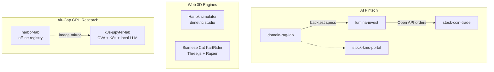
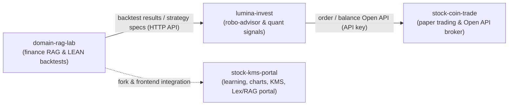
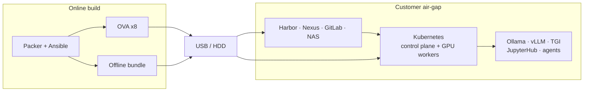

# 🚀 AI Agent · Fintech · 3D Engine · Air-Gap

### **Financial AI agents, browser 3D engines, and air-gapped GPU research platforms**

Domain AI that can run as a cloud service, a self-contained browser runtime, or a disconnected on-prem lab. The same patterns — agents, local inference, containers, and reproducible delivery — show up in fintech, spatial engines, and air-gap GPU platforms.

---

## 🌐 Solution Map

- **Fintech**: independently deployed services, separate databases, REST only (API key auth).
- **3D**: browser engines with no required backend — a procedural dimetric studio and a WebGL physics sim.
- **Air-gap**: VMware OVA delivery into a network with no public internet. Harbor, Nexus, and GitLab mirror images and packages; GPU workers run local LLM, agents, and JupyterHub.

---

## 📈 AI Fintech

Four repositories form a pipeline for financial AI, quant analysis, RAG-based knowledge search, paper trading, and brokerage Open API auto-trading.

- **Integration principle**: `domain-rag-lab`, `lumina-invest`, and `stock-coin-trade` are deployed independently with separate databases and communicate only via REST APIs (API key auth).
- **Portal**: `stock-kms-portal` consolidates `domain-rag-lab` and the investment-analysis web app into a single entry point (port 80).

---

## 📦 Featured Projects

### 1. [stock-kms-portal](https://github.com/edumgt/stock-kms-portal)
Integrated Korean financial learning and investment-analysis KMS portal. `FastAPI` `Vanilla JS` `ApexCharts` `Qdrant` `pgvector` `AWS Lex` `LEAN`
*   **Market charts**: Query domestic and global stock/index prices (Yahoo Finance-based API) with candlestick charts
*   **Financial learning**: 10 learning units, with Mermaid.js diagrams
*   **LEAN backtesting**: Built-in local Docker runner for the QuantConnect LEAN engine
*   **Hybrid chat & RAG**: AWS Lex v2 chatbot combined with Qdrant document RAG
*   **Origin**: Forked from the `domain-rag-lab` structure, with frontends migrated to a single origin

### 2. [stock-coin-trade](https://github.com/edumgt/stock-coin-trade)
Paper-trading platform for stocks (KRX), crypto, and alternative assets, plus brokerage Open API practice. `FastAPI` `AWS SAM` `MariaDB` `PostgreSQL` `Vanilla JS` `Nginx`
*   **Open API**: Virtual account issuing and order execution (`/api/v1/orders`, etc.) for external systems such as `lumina-invest`
*   **Data**: MariaDB for members/trades, PostgreSQL (`pg-stock`) for OHLCV minute/daily bars
*   **Broker integrations**: Korea Investment & Securities (KIS) API/paper trading, KB Securities Open API, Alpaca Paper Trading, TradingView Pine Script
*   **Tooling**: KIS MCP (Model Context Protocol) server with VS Code/Codex integration
*   **Frontend**: Vanilla JavaScript (ES Modules) served by Nginx

### 3. [lumina-invest](https://github.com/edumgt/lumina-invest)
Robo-advisor and quant-signal orchestrator for automated trading. `FastAPI` `Celery` `PostgreSQL` `Redis` `LangChain` `LangGraph` `Qdrant` `Neo4j` `LightGBM`
*   **Auto-trading engine**: Celery Beat runs the `quant.auto_trade_cycle` task every 10 minutes
*   **Orchestration**: Receives strategy specs backtested in `domain-rag-lab`, computes risk limits, and sends orders to `stock-coin-trade` via Open API
*   **AI & ML**: LangChain/LangGraph agents, Scikit-learn and LightGBM models
*   **AWS**: SageMaker training-result lookup and AWS Comprehend sentiment analysis
*   **Storage**: PostgreSQL 16 (SQLAlchemy, asyncpg, Alembic), Redis (sessions, Celery broker/backend)

### 4. [domain-rag-lab](https://github.com/edumgt/domain-rag-lab)
RAG for financial products and asset allocation, with QuantConnect LEAN backtest workflows. `FastAPI` `Streamlit` `Qdrant` `pgvector` `Redis` `Docker`
*   **Hybrid search**: Qdrant vector search and PostgreSQL keyword search fused with Reciprocal Rank Fusion (RRF)
*   **Multi-turn orchestrator**: Session short-term memory and `pgvector`-based long-term memory
*   **Ingestion**: PDF/TXT document ingestion and chunking pipeline
*   **LEAN backtesting**: Local Docker-based QuantConnect LEAN engine
*   **Infrastructure**: Docker Compose, Caddy (TLS reverse proxy), AWS EC2 deployment

### Comparison

| Repository | Domain | Databases | Role |
|---|---|---|---|
| `domain-rag-lab` | Finance RAG & LEAN backtests | PostgreSQL (`pgvector`), Qdrant | Streamlit UI + FastAPI, backtest results |
| `lumina-invest` | Quant signals & robo-advisor | PostgreSQL, Redis, Neo4j, Qdrant | Periodic signals, order triggers |
| `stock-coin-trade` | Stock/crypto/alt-asset paper trading | MariaDB, PostgreSQL (`pg-stock`) | Paper order Open API, KIS/KB/Alpaca |
| `stock-kms-portal` | Learning, charts, KMS portal | PostgreSQL (`pgvector`), Qdrant | Unified UI, AWS Lex + RAG chatbot, LEAN |

---

## 🎮 Web 3D Engines

Browser-native spatial runtimes. Scenes render on the client: a dimetric town studio drawn on Canvas 2D, and a WebGL time-trial with a physics step. Neither needs a game server to place a building or run a lap.

### 5. [A-web-based-Hanok-simulator-game](https://github.com/edumgt/A-web-based-Hanok-simulator-game)
Joseon village studio — a 2:1 dimetric town builder for composing a hanok village and exporting a pixel-perfect snapshot. `React` `Vite` `TypeScript` `Canvas 2D`
*   **World**: 16×16 diamond grid (256 cells), painter’s-algorithm depth sort, nearest-neighbor pixel art
*   **Procedural architecture**: runtime isometric hanok — *gidan*, timber columns, *changhomun*, *giwa* / *choga*, *jangdokdae*, *ondol* chimneys — 56 buildings inside a 256-tile palette
*   **Scene tools**: 90° rotation, day/night lighting, looping mill and water animation, five village presets, undo
*   **Export**: 2,176×1,216 PNG snapshot with preview, download, and clipboard copy
*   **Runtime**: no server and no project file; the map lives in memory until export

### 6. [Siamese-Cat-KartRider](https://github.com/edumgt/Siamese-Cat-KartRider)
Browser 3D time-trial — a 1:87 HO-scale kart on a night-time desk coaster. `Three.js` `Rapier` `WebGL2` `Vite` `Web Audio`
*   **Engine**: single WebGL loop (ACES, bloom, depth-of-field, FXAA) with a Rapier static world and a spline vehicle step
*   **Track**: six-sector banked coaster, drift sparks, apex boost, guardrail penalty, F1-style start lights
*   **Ghost & cameras**: best-lap hologram recorded at 30 Hz (`localStorage`), chase / cockpit / desk orbit / drone cameras, autopilot
*   **Diorama**: millimeter-scale desk and bedroom; GLB props with procedural-mesh fallback
*   **Delivery**: `vite build` bundles models so a race can run from the production dist without a live asset host

---

## 🔒 Air-Gap GPU Research

On-prem platforms for teams that cannot send models, code, or research data to a public cloud. Images, packages, and weights are staged online, then imported from media into a disconnected VMware lab.

### 7. [k8s-jupyter-lab](https://github.com/edumgt/k8s-jupyter-lab)
Air-gap AI agent platform delivered as VMware OVAs — GPU local LLM, JupyterHub, and Kubernetes for an internal research network. `VMware OVA` `Kubernetes` `NVIDIA GPU` `Ollama` `vLLM` `JupyterHub` `Harbor`
*   **Delivery**: Packer/Ansible builds eight OVAs (control plane, three GPU workers, Harbor, Nexus, GitLab, NAS) plus an offline bundle of images, manifests, apt packages, and model files
*   **GPU path**: physical NVIDIA GPU via PCIe passthrough or vGPU, `nvidia-container-runtime` on containerd, CUDA inside the pod
*   **Research stack**: Ollama, vLLM, and TGI for local inference; JupyterHub for notebooks; LangGraph and AutoGen agents; Chroma and Milvus for RAG
*   **Offline coding**: preloaded Ollama models with Codex CLI or Claude Code pointed at the local runtime — no public API required to edit, explain, or draft tests
*   **Install**: `phase1` build online → `phase2` rehearse after boot → `phase3` import and apply inside the air-gap

### 8. [harbor-lab](https://github.com/edumgt/harbor-lab)
Hands-on lab for running Harbor the way an air-gapped network would: internal registry, CA trust, robot accounts, and image import without Docker Hub. `Harbor` `Docker` `kind` `WSL2`
*   **Air-gap flow**: save/load/tar import, proxy-cache concepts, and a preflight that checks images in Harbor before a model deploy
*   **Cluster pull**: kind pulls a Harbor HTTPS image using an image-pull secret and the internal CA
*   **Inference images**: vLLM image skeleton and Kubernetes deploy templates (probes, `imagePullSecret`, NodePort) as the registry side of a GPU research stack

| Repository | Domain | Runtime | Role |
|---|---|---|---|
| `A-web-based-Hanok-simulator-game` | Procedural dimetric studio | Canvas 2D, in-browser | Hanok village composer and PNG export |
| `Siamese-Cat-KartRider` | WebGL 3D engine | Three.js, Rapier, WebGL2 | Desk-scale kart sim, ghost lap, diorama |
| `k8s-jupyter-lab` | Air-gap GPU research platform | VMware OVA, Kubernetes, NVIDIA | Local LLM, JupyterHub, agents, offline bundle |
| `harbor-lab` | Air-gap registry operations | Harbor, Docker, kind | Image mirror, CA trust, offline import |

---

## 🧠 Tech Stack

