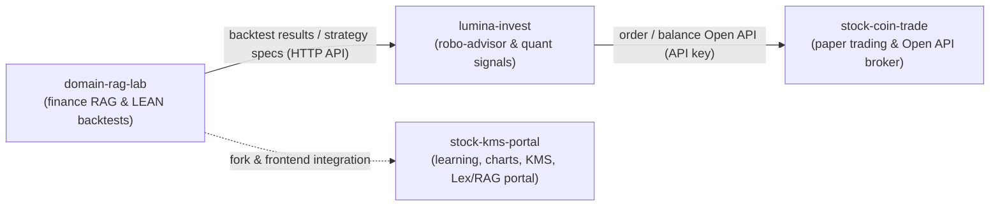

# 🚀 AI Agent · Fintech Solution

### **Building financial-domain AI agents, RAG, quant, and paper-trading platforms**

---

## 🌐 Ecosystem Overview

Four repositories form a pipeline for financial AI, quant analysis, RAG-based knowledge search, paper trading, and brokerage Open API auto-trading.

- **Integration principle**: `domain-rag-lab`, `lumina-invest`, and `stock-coin-trade` are deployed independently with separate databases and communicate only via REST APIs (API key auth).
- **Portal**: `stock-kms-portal` consolidates `domain-rag-lab` and the investment-analysis web app into a single entry point (port 80).

---

## 📦 Featured Projects

### 1. [stock-kms-portal](https://github.com/edumgt/stock-kms-portal)
Integrated Korean financial learning and investment-analysis KMS portal. `FastAPI` `Vanilla JS` `ApexCharts` `Qdrant` `pgvector` `AWS Lex` `LEAN`
*   **Market charts**: Query domestic and global stock/index prices (Yahoo Finance-based API) with candlestick charts
*   **Financial learning**: 10 learning units, with Mermaid.js diagrams
*   **LEAN backtesting**: Built-in local Docker runner for the QuantConnect LEAN engine
*   **Hybrid chat & RAG**: AWS Lex v2 chatbot combined with Qdrant document RAG
*   **Origin**: Forked from the `domain-rag-lab` structure, with frontends migrated to a single origin

### 2. [stock-coin-trade](https://github.com/edumgt/stock-coin-trade)
Paper-trading platform for stocks (KRX), crypto, and alternative assets, plus brokerage Open API practice. `FastAPI` `AWS SAM` `MariaDB` `PostgreSQL` `Vanilla JS` `Nginx`
*   **Open API**: Virtual account issuing and order execution (`/api/v1/orders`, etc.) for external systems such as `lumina-invest`
*   **Data**: MariaDB for members/trades, PostgreSQL (`pg-stock`) for OHLCV minute/daily bars
*   **Broker integrations**: Korea Investment & Securities (KIS) API/paper trading, KB Securities Open API, Alpaca Paper Trading, TradingView Pine Script
*   **Tooling**: KIS MCP (Model Context Protocol) server with VS Code/Codex integration
*   **Frontend**: Vanilla JavaScript (ES Modules) served by Nginx

### 3. [lumina-invest](https://github.com/edumgt/lumina-invest)
Robo-advisor and quant-signal orchestrator for automated trading. `FastAPI` `Celery` `PostgreSQL` `Redis` `LangChain` `LangGraph` `Qdrant` `Neo4j` `LightGBM`
*   **Auto-trading engine**: Celery Beat runs the `quant.auto_trade_cycle` task every 10 minutes
*   **Orchestration**: Receives strategy specs backtested in `domain-rag-lab`, computes risk limits, and sends orders to `stock-coin-trade` via Open API
*   **AI & ML**: LangChain/LangGraph agents, Scikit-learn and LightGBM models
*   **AWS**: SageMaker training-result lookup and AWS Comprehend sentiment analysis
*   **Storage**: PostgreSQL 16 (SQLAlchemy, asyncpg, Alembic), Redis (sessions, Celery broker/backend)

### 4. [domain-rag-lab](https://github.com/edumgt/domain-rag-lab)
RAG for financial products and asset allocation, with QuantConnect LEAN backtest workflows. `FastAPI` `Streamlit` `Qdrant` `pgvector` `Redis` `Docker`
*   **Hybrid search**: Qdrant vector search and PostgreSQL keyword search fused with Reciprocal Rank Fusion (RRF)
*   **Multi-turn orchestrator**: Session short-term memory and `pgvector`-based long-term memory
*   **Ingestion**: PDF/TXT document ingestion and chunking pipeline
*   **LEAN backtesting**: Local Docker-based QuantConnect LEAN engine
*   **Infrastructure**: Docker Compose, Caddy (TLS reverse proxy), AWS EC2 deployment

### Comparison

| Repository | Domain | Databases | Role |
|---|---|---|---|
| `domain-rag-lab` | Finance RAG & LEAN backtests | PostgreSQL (`pgvector`), Qdrant | Streamlit UI + FastAPI, backtest results |
| `lumina-invest` | Quant signals & robo-advisor | PostgreSQL, Redis, Neo4j, Qdrant | Periodic signals, order triggers |
| `stock-coin-trade` | Stock/crypto/alt-asset paper trading | MariaDB, PostgreSQL (`pg-stock`) | Paper order Open API, KIS/KB/Alpaca |
| `stock-kms-portal` | Learning, charts, KMS portal | PostgreSQL (`pgvector`), Qdrant | Unified UI, AWS Lex + RAG chatbot, LEAN |

---

## 🧠 Tech Stack

